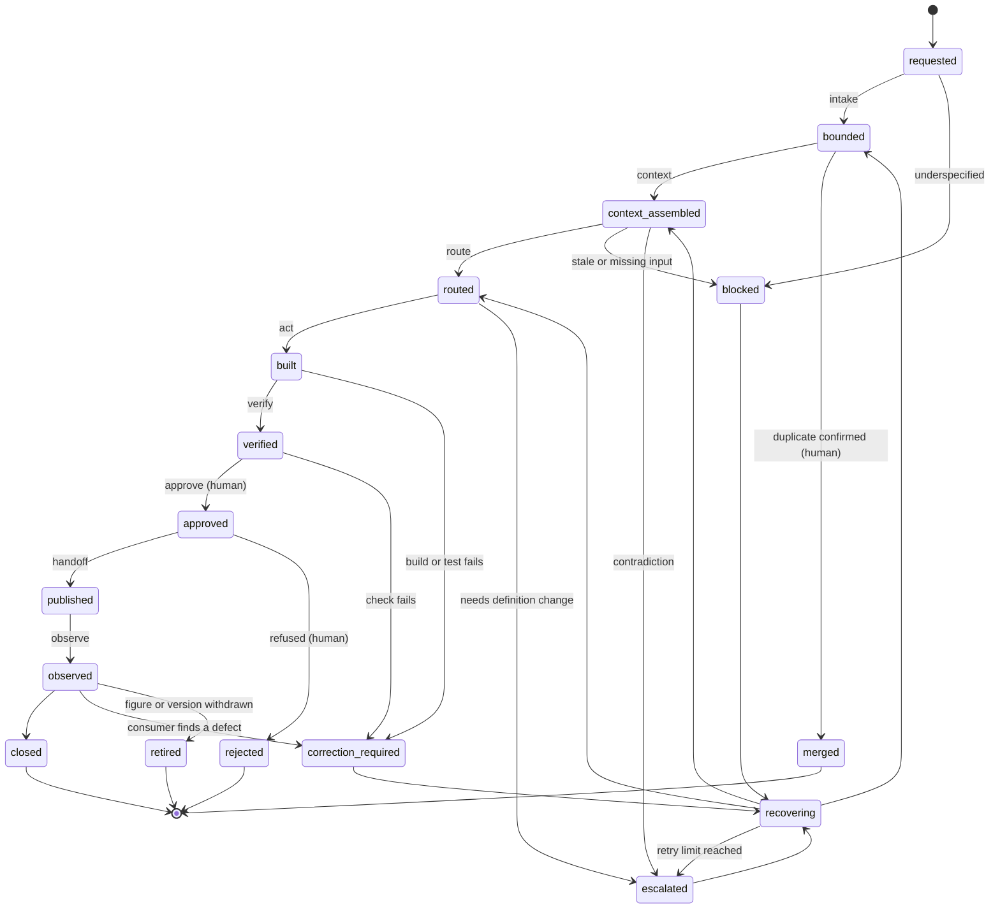

# Lifecycle worksheet

Track repository read: `techindicium/portwell-analytics` at `a8aecb4` (committed 2026-09-09). It was
read and built in a scratch clone. It was not modified.

## Selected work item

| Field | Value |
| :- | :- |
| Track | DDLC, Data Development Lifecycle |
| Process | The month's figures are produced |
| Work item | `REQUEST-007`, self-service per account for the August packs |
| Intended outcome | Reporting (Lucia Ferreira) receives a per-account self-service figure for August 2026 that names its metric, its definition version, its period and the extract it was computed from, so the August service review packs can quote it (`POLICY-13`) and it can be reconciled with July later |
| Current owner | Declan Byrne, per `data/tracker.csv` (no owner field exists in `data/requests/inbox.csv`) |
| Due | 2026-09-04, per `data/requests/inbox.csv`, `data/tracker.csv` and `data/requests/REQUEST-007.docx` (the three agree) |
| Audience | Customer-facing. The figure goes into service review packs sent to accounts |

The question this track answers: what has to be established before a definition or a model can be
published and used by somebody else? For `REQUEST-007` the answer turned out to be four facts, and
the current process records none of them: which definition version, which period the extract
actually covers, whether the model implements that version, and who consumes the result.

## Current process

What actually happened to `REQUEST-007`, reconstructed from the records. Dates are as recorded.
Where nothing was recorded the cell says unknown.

| Step | Actor | System or artifact | Input | Output | Decision | Evidence | Problem or unknown |
| -: | :- | :- | :- | :- | :- | :- | :- |
| 1 | Sofia Marques (author), Declan Byrne (reviewer) | `project/metrics/metric-definitions.yaml`, `docs/pr-notes/0088-self-service-v3.md` | Need to stop counting rewritten drafts as self-service | `self_service_rate` v3, merged 2026-06-27, effective 2026-07-01 | Change the definition; leave the mart on v2 until June closed | Change note 0088 | The mart was never updated. Nobody was told. `POLICY-05` (announce one period ahead) not met because no consumer list exists |
| 2 | Lucia Ferreira (Reporting) | `data/requests/inbox.csv` `REQUEST-004` | July packs need self-service | July figure from `marts.self_service`, status `done` | Answer from the existing mart | inbox row, `REQUEST-007.docx` note | Version used for July is not recorded. The mart in the repository today computes v2 and change note 0088 says it was not updated; if it was the same in early August, July went out on v2 while the definitions file said v3. Whether it was the same is not recorded |
| 3 | Sunder Retail Supply, analytics lead | `docs/incidents/INCIDENT-03.md`, `TICKET-004424` | Customer asks why self-service moved June to July | Explanation two days later | None. "Nothing was changed" | INCIDENT-03 | **Contradiction, unresolved.** INCIDENT-03 says the figure moved because the definition went v2 to v3. Change note 0088 says the mart still computes v2. Our build shows Sunder at 0.0 in June and 0.3478 in July on the v2 mart, which is also consistent with the pilot starting. Both sources reported; neither chosen |
| 4 | Lucia Ferreira | `data/requests/inbox.csv`, `REQUEST-007.docx` | "The same self-service number we had in July, per account, for the August packs" | `REQUEST-007`, status `open`, needed by 2026-09-04 | Register the request | inbox row dated 2026-08-11 | **Information lost here.** The request asks for "the same number as July" and does not name a version. "The same as July" means v2 as computed; the current definition is v3. Nobody asked |
| 5 | Henrik Sole (Reporting) | `data/requests/inbox.csv`, `REQUEST-011.docx` | "Automation rate per Enterprise account, share of tickets handled without a person" | `REQUEST-011`, no owner in tracker | Register separately | inbox row dated 2026-08-18 | Possibly the same number as `REQUEST-007`. `ISSUE-36` opened 2026-08-19. Nobody has asked either requester |
| 6 | Data engineer (Declan Byrne per manifest; "usually Joao" per interview) | `data/ops-extract/`, `extract-manifest.yaml` | Operational database | Extract `taken_at: 2026-08-28T09:14:00Z`, covers tickets opened before 2026-08-28 | Take the extract on 2026-08-28 | Manifest | **Contradiction, unresolved.** Manifest says `taken_by: Declan Byrne`; the interview (2026-08-12) says someone in support runs the query, "usually Joao". Extract ends 2026-08-27 18:57, so August is four days short. Nothing compares `taken_at` to the reporting period |
| 7 | Unknown | `project/run.py` | Extract | Warehouse with `marts.self_service` | Unknown whether the August build was run, when, or by whom | None. `staging.extract_metadata` records the build time (`now()`), not the extract time, and is overwritten by the next build | Build is the one step that works. Its six tests pass on the v2 mart |
| 8 | Unknown | Unknown (CSV or pasted message, per interview) | August figure | Unknown | Unknown | None. `REQUEST-007` is still `open` in both inbox and tracker; tracker `last_touched` 2026-08-28 | Whether any August figure was sent, in what form and on which version, is unknown. If pasted into a message, "there is no file" (interview) |
| 9 | Nobody | No consumer list (`ISSUE-30`) | Version change | Nothing | Nothing | None | Consumers of `self_service_rate`: packs, help portal (pins no version), board slide from `REQUEST-005`. None of them is recorded as a consumer anywhere |

**The red state.** On a scratch clone the build returns `OK: 0 failing test(s)` while
`marts.self_service` implements v2 and the definition in force is v3. The tests check that a
number is a share between 0 and 1. They do not check which definition it implements. The full
output is in `evidence/REQUEST-007/act-build-output.txt`.

## Proposed lifecycle

The managed unit is a metric figure request. A figure is identified by metric name, definition
version, period and audience. A state is reached only when its evidence file exists under
`evidence/<ITEM>/` and a row is appended to `state/transitions.md`.

| Common stage | Track-specific state | Entry conditions | Evidence produced | Next states | Owner | Stop or escalation condition |
| :- | :- | :- | :- | :- | :- | :- |
| Intake | `bounded` | A `REQUEST-NNN` row exists in `data/requests/inbox.csv`; requester named | `intake-record.md`: metric name, **version**, period (first and last day), grain, audience (internal or customer-facing), needed-by, consumer, non-goals, possible duplicates | `context-assembled`, `blocked` (underspecified), `escalated` (possible duplicate), `merged` | Data engineer | Version, period or audience not stated in the request: stop, ask the requester. Possible duplicate in inbox: stop, escalate to metric owner |
| Context | `context-assembled` | `bounded`; intake record lists version and period | `context-manifest.md`: every artifact read with path, source and age (or "unknown"); definition block for the version; extract `taken_at` and max event date vs period; model file for the metric; applicable policies; known consumers; contradictions found | `routed`, `blocked`, `escalated` | Data engineer | Extract does not cover the period; required column absent from the extract; two sources disagree on a fact the item depends on |
| Route | `routed` | `context-assembled`, no open contradiction | `route-decision.md`: path (A standard refresh, B definition-change, C ad-hoc analysis), autonomy level, required reviewers, required evidence for verify | `built`, `escalated` | Data engineer proposes; metric owner confirms path B and C | Mart does not implement the requested version (path B needs a human); destructive rebuild needed (`POLICY-06` needs a named approver) |
| Act | `built` | `routed` on path A, or path B with the model change approved | `act-build-output.txt` (full `project/run.py` output), `figure-draft.csv` with columns `account_id, period, metric, version, value, extract_taken_at` | `verified`, `correction-required` | Data engineer | Build or load fails; agent would need to edit the track repo or a published definition to proceed |
| Verify | `verified` | `built` | `verification-report.md`: each check, its result and its query; shape tests are recorded but are not sufficient | `approved` (via human), `correction-required`, `escalated` | Second reader (an analytics member other than the author) | Any check below fails; a figure differs from the prior period by more than the threshold with no recorded reason |
| Approve | `approved` | `verified`; verification report has no failing check | `approval-record.md` written by the approver: name, role, date, what was approved (metric, version, period, audience), conditions | `published`, `rejected`, `correction-required` | Metric owner (Sofia Marques, per `metric-definitions.yaml`) | The skill never writes an approval. Without a named human decision the item stays in `verified` |
| Handoff | `published` | `approved` | `handoff-record.md`: file delivered, recipient, channel, checksum; the figure file itself names metric, version, period and extract; consumer added to the consumer register | `observed` | Data engineer | Delivery would be a pasted number with no file; recipient not in the consumer register |
| Observe | `observed` | `published`; the pack has gone out | `observation.md`: customer tickets or questions about the figure, consumer-reported discrepancies, whether consumers pinned the version, next-period comparison | `closed`, `correction-required`, `retired`, new linked item | Metric owner | A consumer question cannot be answered from the recorded evidence within one business day |
| Recover | `recovering` | Item in `blocked`, `escalated`, `correction-required` or `rejected` | `recovery-log.md`: failure class, cause (model, data, specification, fixture, process), action, retry count, decision requested and from whom | Back to the state that failed, `escalated`, `rejected`, `retired` | Data engineer; escalations to metric owner | Retry limit for the failure class reached; decision belongs to a human |

### Verification checks, in order (cheapest first)

1. Extract coverage: `extract-manifest.yaml` `taken_at` is after the last day of the period, and the
   latest `opened_at` in the extract reaches the last day of the period.
2. Load and shape: `project/run.py` exit code 0 and all six shape tests pass.
3. Definition match: the mart logic implements the requested version's numerator, denominator and
   exclusions. Today this is a reading of `self_service.sql` and `stg_suggestions.sql` against the
   definition block. It is the check that would have caught the v2/v3 drift.
4. Applicability: non-pilot accounts carry "not applicable", not 0.0 (`ISSUE-32`).
5. Denominator: the denominator matches the definition ("tickets closed in the period"), not
   tickets opened.
6. Continuity: if the prior period's figure was on a different version, the report says so and
   names both versions.

### Fully specified states

#### `context-assembled`

| Field | Value |
| :- | :- |
| Entry condition | Item is `bounded`: `intake-record.md` exists and names metric, version, period, audience and requester |
| Required evidence | `evidence/<ITEM>/context-manifest.md` listing each artifact read with path, source and age (or unknown), the definition block for the requested version, extract coverage (`taken_at`, earliest and latest event date) against the period, the model files that compute the metric, applicable policies, consumers known for the metric, and every contradiction found with both sources |
| Exit condition | Every input the route decision needs has a source and an age; extract covers the period; no contradiction on a fact the item depends on is open |
| Owner | Data engineer (Declan Byrne today) |
| Allowed transitions | `routed`; `blocked` (stale extract, missing column, missing source); `escalated` (contradiction) |
| Failure path | Stale or short extract: `blocked` awaiting a new extract, one re-extract per due date, then `escalated` to the metric owner. Contradiction: `escalated` immediately, no retry |

#### `verified`

| Field | Value |
| :- | :- |
| Entry condition | Item is `built`: `act-build-output.txt` shows exit code 0, and `figure-draft.csv` exists with metric, version, period and extract columns |
| Required evidence | `evidence/<ITEM>/verification-report.md` with checks 1 to 6 above, each with its query or reading, result, and the reader's name. A green shape-test run on its own is not this evidence |
| Exit condition | All six checks pass, and the report is read by someone other than the author of the model change |
| Owner | Second reader, an analytics member who did not write the change |
| Allowed transitions | Proposed `approved` (only a human moves it there); `correction-required`; `escalated` |
| Failure path | Check 2 fails: `correction-required`, up to 3 build iterations, then `escalated`. Check 3 fails: `correction-required` on path B, which needs the metric owner, so `escalated`. Checks 1, 4, 5 fail: `blocked` or `correction-required` per the failure table |

## Human judgment boundaries

| Decision | Why it is not mechanical | Decision owner | Evidence prepared by a skill |
| :- | :- | :- | :- |
| Which definition version a figure uses when the request does not say | "The same number as July" and "the current definition" are different answers, and only the consumer knows which comparison they need | Requester (Lucia Ferreira) with metric owner (Sofia Marques) | Intake record showing the request text, the versions in force, and what July was computed on |
| Whether two requests ask for the same number (`REQUEST-007`, `REQUEST-011`) | The requesters use different words ("self-service", "automation rate") and different scopes (all accounts, Enterprise only) | Metric owner, after asking both requesters | Side-by-side of both request texts, scopes and due dates |
| Whether a definition change is safe while a reporting period is open (`POLICY-05`) | Trades comparability with last month against correctness this month | Metric owner (owner of `POLICY-05`) | Consumer list, prior-period version, announcement date |
| Whether to compute a figure from an extract that does not cover the whole period | The requester may prefer a late figure or a partial one with a caveat | Requester with metric owner | Coverage gap in days and tickets |
| Model wrong versus data wrong | Needs knowledge of the operational system the extract does not carry | Data engineer, escalating to metric owner | Failing check, query, and the rows that fail |
| Destructive rebuild of a mart (`POLICY-06`) | Policy requires a named approver; `rebuild.py` asks nothing (`ISSUE-37`) | Named approver (metric owner by default) | Which table, why, what is lost |
| Whether a figure is fit to leave the team, and for which audience | Customer-facing figures carry contractual weight | Metric owner | Verification report |

## Failure and recovery

| Failure or blocked state | Detection signal | Recovery path | Retry limit | Escalation owner |
| :- | :- | :- | :- | :- |
| `blocked`: request underspecified | Intake record has an empty version, period or audience | Ask the requester the specific missing field, in writing | 2 rounds or 3 business days | Metric owner |
| `escalated`: possible duplicate request | Another open request names the same metric or a synonym for the same period | Present both to the metric owner; outcome is `merged` or both continue with distinct definitions | 0 (human decision) | Metric owner |
| `blocked`: extract does not cover the period | `taken_at` before period end, or latest `opened_at` before period end | Request a new extract using the current query | 1 per due date | Metric owner, who decides with the requester whether a partial figure is acceptable |
| `blocked`: extract schema drift | Load fails or expected columns absent | Compare extract columns with the current query version; re-request | 1 | Data engineer |
| `blocked`: required source column absent | Definition needs a field the extract does not carry (v3 needs `human_edit_material` and reopen time) | Raise a linked request to Portal engineering for the field | 0, it is a cross-team dependency | Metric owner |
| `correction-required`: mart does not implement the requested version | Verify check 3 | Model change on path B, second reader, `POLICY-05` announcement | 3 build iterations | Metric owner |
| `correction-required`: shape test fails | `project/run.py` reports FAIL | Fix the model, rebuild | 3 | Data engineer, then metric owner |
| `escalated`: two sources contradict | Context manifest lists a contradiction on a fact the item depends on | Report both; ask the owner of each source | 0 | Metric owner |
| `rejected`: approver refuses | Approval record says refused | Close, or reopen as a new linked request | n/a | Requester informed by metric owner |
| `correction-required` after publication | Customer ticket or consumer reports the figure is wrong or moved | New linked item; mark the published figure as under correction | n/a | Metric owner |

## Terminal states

| State | Business outcome represented | Required final evidence |
| :- | :- | :- |
| `closed` | The figure was published with metric, version, period and extract named, and one observation window passed with no unresolved consumer question | `handoff-record.md`, `observation.md`, consumer register entry |
| `rejected` | The figure was not published; the requester was told why | `approval-record.md` (refused) written by the approver, notification to requester |
| `merged` | The request was a duplicate and is answered by another item | Decision by metric owner naming the surviving item |
| `retired` | A published figure or definition version is withdrawn and consumers were told | Retirement note naming the replacement and the consumers notified |

## Controls observed missing (recorded, not built)

Per the track guide, controls are not built in Module 1. Each is named with what it would protect.

| Missing control | Would protect | Incident or record |
| :- | :- | :- |
| Compare extract `taken_at` and max event date to the reporting period before building | Figures built on the wrong or short month | Interview (March built on February), extract ends 2026-08-27 |
| Check that a mart implements the definition version it is published under | Silent v2/v3 drift | Change note 0088, INCIDENT-03 |
| Figures carry metric and version out of the warehouse | `POLICY-13` | `docs/policies.md` |
| Consumer register per metric | `POLICY-05` announcement | `ISSUE-30`, INCIDENT-03 |
| Approver argument on `rebuild.py` | `POLICY-06` | `ISSUE-37` |
| `staging.extract_metadata` records the extract time, not the build time | Answering "how old is this number" | `stg_extract_metadata.sql` uses `now()` |

## Open questions

- Which version does `REQUEST-007` want: v2 to match July, or v3 as currently defined? Unanswered.
- Are `REQUEST-007` and `REQUEST-011` the same number? Unanswered (`ISSUE-36`).
- Did the June to July movement for Sunder come from the definition change (INCIDENT-03) or from the
  pilot starting (the v2 mart shows 0.0 in June)? Unresolved contradiction.
- Who took the 2026-08-28 extract: Declan Byrne (manifest) or someone in support (interview)?
  Unresolved contradiction.
- Was any August figure sent to Reporting, in what form, on which version? Unknown.
- Is Sofia Marques the "analytics lead" quoted in `docs/how-we-work-today.md` and INCIDENT-03? Not
  recorded. She is the metric owner and the owner of `POLICY-05`, `POLICY-06` and `POLICY-13`.
- `POLICY-11` is cited in `REQUEST-009.docx` but does not appear in `docs/policies.md`. Unknown
  whether it exists.
- `README.md` in the track repo describes `scripts/lifecycle.py`, `state/` and `evidence/`; none of
  them exist in the repository. Recorded as a difference between the course layer and the fixture.
